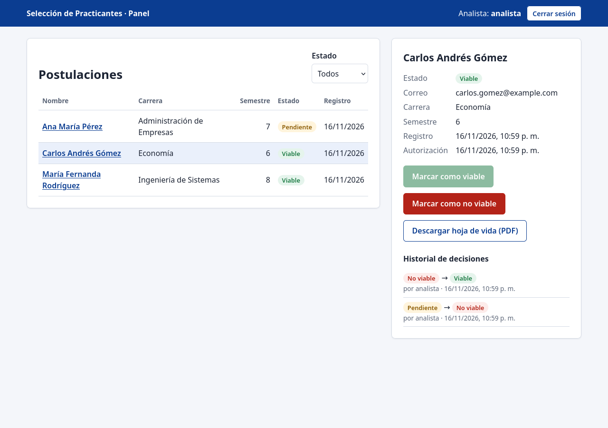
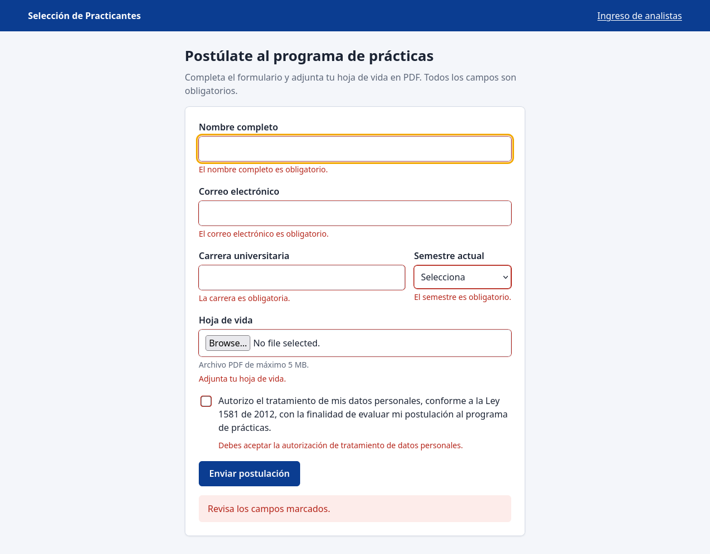
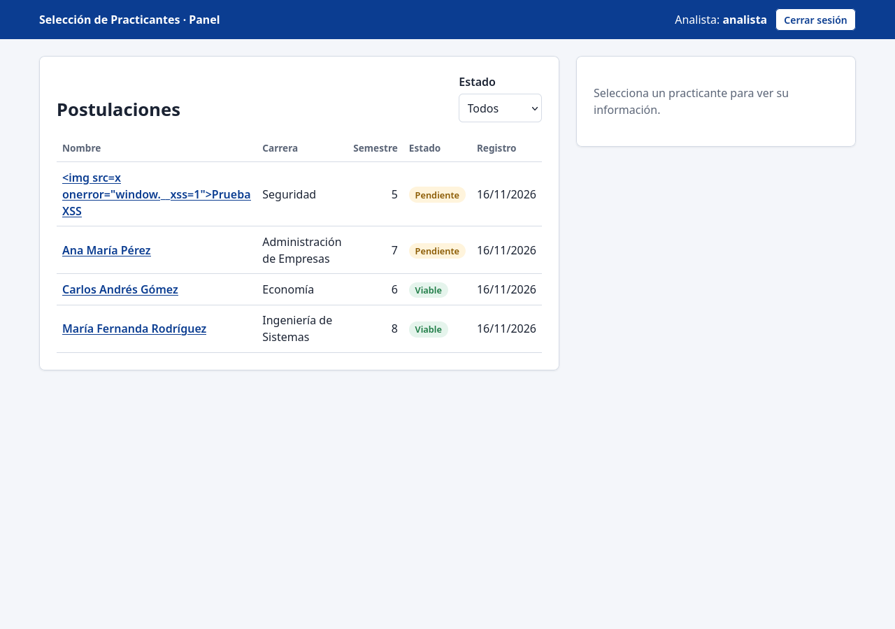

# Plataforma de Selección de Practicantes

[](https://github.com/danielxzr2/prueba-bancob/actions/workflows/ci.yml)

Herramienta web para que **practicantes** registren su información y hoja de vida, y para que
**analistas de selección** revisen cada postulación y la marquen como _viable_ o _no viable_.

Construida con **documentación prescriptiva** y **TDD**: los [requisitos](docs/requisitos.md) y el
[contrato de la API](docs/openapi.yaml) se escribieron antes del código, el servidor aplica el
contrato en cada petición y cada requisito está enlazado a las pruebas que lo verifican en la
[matriz de trazabilidad](docs/requisitos.md#6-matriz-de-trazabilidad).



| Validación en el formulario                                          | Un nombre con HTML se muestra como texto (XSS)                                |
| -------------------------------------------------------------------- | ----------------------------------------------------------------------------- |
|  |  |

## Funcionalidades

| Funcionalidad                                                              | Requisitos           |
| -------------------------------------------------------------------------- | -------------------- |
| Formulario de postulación con validación en el navegador y en el servidor  | RF-01 a RF-03        |
| Hoja de vida en PDF (verificada por contenido, máximo 5 MB) y correo único | RF-01, RF-04         |
| Autorización de tratamiento de datos (Ley 1581 de 2012)                    | RNF-09               |
| Inicio y cierre de sesión de analistas _(desafío opcional 1)_              | RF-05                |
| Panel: lista con filtro por estado, detalle y decisión viable / no viable  | RF-06 a RF-08, RF-11 |
| Descarga de la hoja de vida desde el panel _(desafío opcional 2)_          | RF-09                |
| Bitácora de auditoría: quién decidió qué y cuándo                          | RF-10                |

## Requisitos previos

- **Node.js 22.9 o superior** (`node --version`)
- **npm 10 o superior** (incluido con Node.js)

No se necesita ninguna base de datos ni servicio externo: SQLite se crea automáticamente.

> `better-sqlite3` descarga un binario precompilado para Windows, macOS y Linux. Solo en plataformas
> poco comunes necesitaría compilarse (Python y un compilador de C++).

## Instalación y ejecución

```bash
git clone https://github.com/danielxzr2/prueba-bancob.git
cd prueba-bancob
npm install
npm run seed   # crea el analista de prueba (ver abajo)
npm run dev
```

El servidor se reinicia solo al cambiar el código (para ejecutarlo sin recarga: `npm start`).

| Página                           | Para quién                                       |
| -------------------------------- | ------------------------------------------------ |
| http://localhost:3000            | Practicantes: formulario de postulación          |
| http://localhost:3000/login.html | Analistas: inicio de sesión (usuario del seed)   |
| http://localhost:3000/panel.html | Analistas: lista, filtro, detalle, decisión y CV |

### Usuario analista

`npm run seed` crea el usuario **`analista`**. En el repositorio no hay ninguna contraseña escrita:

- Si defines `ANALYST_PASSWORD` en `.env`, se usa esa contraseña.
- Si no, el comando **genera una aleatoria y la muestra una sola vez** en la consola.

Puedes volver a ejecutar `npm run seed` en cualquier momento para cambiar la contraseña.

## Pruebas y calidad

```bash
npm test               # 130 pruebas unitarias, de integración y de arquitectura (Jest + Supertest)
npm run test:coverage  # pruebas + reporte de cobertura en coverage/lcov-report/index.html
npm run test:e2e       # 16 controles en un navegador real (requiere Firefox)
npm run lint           # ESLint
npm run format:check   # verificar formato (Prettier); npm run format lo corrige
```

- **TDD visible en el historial:** cada `feat(...)` está precedido por su `test(...)` en rojo, y los
  nombres de las pruebas incluyen el criterio de aceptación que verifican (`CA-04.1 ...`).
- **Cobertura:** 96 % de líneas y 80 % de ramas. Se mide, pero no es la meta: una prueba puede cubrir
  una línea sin verificarla.
- **Mutaciones:** después de cada ciclo se rompió el código a propósito para comprobar que alguna
  prueba falla. Así aparecieron huecos que la cobertura no mostraba (ver
  [Uso de IA](#uso-de-ia-en-el-desarrollo)).
- **Pruebas de arquitectura:** fallan si un servicio importa Express o una ruta accede a la base de
  datos sin pasar por un servicio.
- **E2E:** `npm run test:e2e` levanta la app con datos temporales y maneja Firefox headless con
  WebDriver BiDi, sin dependencias adicionales. Con `-- --screenshots` regenera las capturas de
  `docs/img/`. No corre en CI porque allí no hay navegador.
- **CI:** GitHub Actions ejecuta lint, formato y pruebas en cada push a `main`.

## Seguridad

| Riesgo                      | Medida                                                                                    |
| --------------------------- | ----------------------------------------------------------------------------------------- |
| Acceso al panel sin permiso | Sesión con cookie `HttpOnly` + `SameSite=Strict`; todas las rutas del panel exigen sesión |
| Robo o fijación de sesión   | El id de sesión se regenera al iniciar sesión y se destruye en el servidor al cerrarla    |
| Contraseñas                 | bcrypt (costo 12); misma respuesta y mismo tiempo exista o no el usuario                  |
| Inyección SQL               | Consultas siempre parametrizadas, con pruebas de inyección                                |
| XSS                         | Datos pintados solo como texto, ESLint prohíbe `innerHTML`, CSP sin `unsafe-inline`       |
| Archivos maliciosos         | Firma `%PDF-` verificada por contenido, 5 MB máximo, nombre UUID, sin acceso directo      |
| Inyección de cabeceras      | Nombre de descarga normalizado a `[a-z0-9-]`                                              |
| Datos personales            | Autorización expresa (Ley 1581), sin correos en la lista ni datos personales en los logs  |
| Secretos                    | Ningún secreto en el repositorio; contraseña del seed y secreto de sesión aleatorios      |

## Decisiones técnicas

Cada decisión relevante tiene un ADR con el contexto, las alternativas y sus consecuencias:

- [0001](docs/adr/0001-contrato-openapi-como-fuente-de-verdad.md) — El contrato OpenAPI se escribe primero y el servidor lo aplica
- [0002](docs/adr/0002-sesion-con-cookie-en-lugar-de-jwt.md) — Sesión con cookie en lugar de JWT
- [0003](docs/adr/0003-sqlite-con-better-sqlite3.md) — SQLite con better-sqlite3, sin ORM
- [0004](docs/adr/0004-almacenamiento-de-hojas-de-vida.md) — Hojas de vida: validar en memoria, guardar con UUID, sin acceso directo
- [0005](docs/adr/0005-frontend-sin-framework-y-defensa-xss.md) — Frontend sin framework y defensa contra XSS en tres capas
- [0006](docs/adr/0006-estrategia-de-pruebas.md) — TDD, mutaciones manuales y E2E en navegador real

Los diagramas (casos de uso, componentes, modelo de datos y secuencias) están en
[`docs/arquitectura.md`](docs/arquitectura.md).

## Uso de IA en el desarrollo

Desarrollé este proyecto con un asistente de IA (Claude Code). La IA fue una herramienta para
proponer diseño e implementación; las decisiones de enfoque y alcance, y la responsabilidad por cada
línea, son mías. El proceso se diseñó para que los errores de la IA se detecten.

**Cómo se controló**

- [`CLAUDE.md`](CLAUDE.md) fija las reglas para el asistente: no implementar nada que no esté en los
  requisitos, TDD obligatorio, Definición de Hecho y reglas de seguridad no negociables. Al estar
  versionado, las reglas son auditables.
- Nada se dio por bueno sin evidencia: pruebas en rojo antes del código, mutaciones, E2E en
  navegador y la instalación verificada en un clon limpio del repositorio.

**Errores que el proceso detectó**

| Qué pasó                                                                                   | Cómo se detectó                       | Commit    |
| ------------------------------------------------------------------------------------------ | ------------------------------------- | --------- |
| Una prueba de correo único mezclaba dos casos y fallaba por otra razón                     | Al ejecutar la prueba                 | `812c170` |
| Pruebas de validación pasaban por la razón equivocada (un error de tipo ocultaba la regla) | Mutación: desactivar `coerceTypes`    | `f719c06` |
| La prueba de logout pasaba aunque la sesión seguía válida en el servidor                   | Mutación: quitar `session.destroy`    | `12ce398` |
| La bitácora podía registrar al analista equivocado sin que fallara ninguna prueba          | Mutación: analista fijo               | `c1ee2a9` |
| `npm run dev` fallaba si no existía `.env`                                                 | Siguiendo el README en un clon limpio | `7125fe8` |
| ESLint aplicaba los globales de Node al código del navegador                               | Mutación: `require` en el frontend    | `6fcf57d` |
| La columna "Ver detalle" quedaba oculta y la confirmación del registro, fuera de vista     | Revisando capturas del navegador      | `091379e` |

**Uso descartado a propósito:** calificar hojas de vida automáticamente con IA. Hay riesgo de sesgo,
implicaría enviar datos personales a un tercero y la decisión de selección debe ser humana.

## Qué haría con más tiempo

- **Seguridad:** límite de intentos de inicio de sesión, sesiones en un almacén persistente (Redis)
  con cookie `secure` detrás de HTTPS y análisis antivirus de los archivos.
- **Producto:** paginación y búsqueda por nombre en el panel, comentarios del analista en cada
  decisión, notificación al practicante y roles (analista / administrador).
- **Datos personales:** política de retención y eliminación (derecho de supresión, Ley 1581).
- **Calidad:** mutation testing automatizado (Stryker), E2E en CI con un navegador en contenedor y
  pruebas automáticas de accesibilidad (axe).
- **Operación:** contenedor Docker, logs estructurados y despliegue.

## API

La especificación completa está en [`docs/openapi.yaml`](docs/openapi.yaml). Todas las respuestas de
error tienen el formato `{ "error": { "code", "message", "details?" } }`.

| Método | Ruta                                   | Descripción                    | Sesión |
| ------ | -------------------------------------- | ------------------------------ | ------ |
| POST   | `/api/applicants`                      | Registrar postulación          | No     |
| POST   | `/api/auth/login` · `/api/auth/logout` | Iniciar y cerrar sesión        | —      |
| GET    | `/api/auth/me`                         | Sesión actual                  | Sí     |
| GET    | `/api/applicants?status=`              | Listar practicantes            | Sí     |
| GET    | `/api/applicants/{id}`                 | Detalle                        | Sí     |
| PUT    | `/api/applicants/{id}/status`          | Marcar como viable o no viable | Sí     |
| GET    | `/api/applicants/{id}/status-history`  | Bitácora de decisiones         | Sí     |
| GET    | `/api/applicants/{id}/cv`              | Descargar hoja de vida         | Sí     |

<details>
<summary>Ejemplos con curl</summary>

Registrar una postulación (reemplaza la ruta por la de un PDF real):

```bash
curl -X POST http://localhost:3000/api/applicants \
  -F fullName="Ana María Pérez" \
  -F email=ana.perez@example.com \
  -F career="Ingeniería de Sistemas" \
  -F semester=7 \
  -F dataConsent=true \
  -F cv=@/ruta/a/hoja-de-vida.pdf
# 201 {"id":1,"status":"PENDIENTE","createdAt":"..."}
```

Iniciar sesión (guarda la cookie en `cookies.txt`) y usar el panel:

```bash
curl -c cookies.txt -X POST http://localhost:3000/api/auth/login \
  -H "Content-Type: application/json" \
  -d '{"username": "analista", "password": "<contraseña del seed>"}'

curl -b cookies.txt "http://localhost:3000/api/applicants?status=PENDIENTE"
curl -b cookies.txt http://localhost:3000/api/applicants/1
curl -b cookies.txt -X PUT http://localhost:3000/api/applicants/1/status \
  -H "Content-Type: application/json" -d '{"status": "VIABLE"}'
curl -b cookies.txt http://localhost:3000/api/applicants/1/status-history
curl -b cookies.txt -OJ http://localhost:3000/api/applicants/1/cv
curl -b cookies.txt -X POST http://localhost:3000/api/auth/logout
```

</details>

## Configuración

Todo funciona sin configuración. Para cambiar algún valor, copia `.env.example` como `.env`:

| Variable           | Por defecto                | Descripción                                                                   |
| ------------------ | -------------------------- | ----------------------------------------------------------------------------- |
| `PORT`             | `3000`                     | Puerto del servidor                                                           |
| `DATABASE_PATH`    | `data/app.sqlite`          | Archivo de la base de datos SQLite                                            |
| `UPLOADS_DIR`      | `uploads`                  | Carpeta privada donde se guardan las hojas de vida                            |
| `SESSION_SECRET`   | aleatorio en cada arranque | Secreto de la cookie de sesión. Sin él, las sesiones se cierran al reiniciar. |
| `ANALYST_USERNAME` | `analista`                 | Usuario que crea `npm run seed`                                               |
| `ANALYST_PASSWORD` | aleatoria                  | Contraseña que asigna `npm run seed` (mínimo 8 caracteres)                    |
| `FIREFOX_BIN`      | `firefox`                  | Navegador para `npm run test:e2e`                                             |

Para reiniciar los datos locales, detén el servidor y borra las carpetas `data/` y `uploads/`.

## Estructura del proyecto

```
docs/
  requisitos.md     Requisitos, criterios de aceptación y matriz de trazabilidad
  openapi.yaml      Contrato de la API (el servidor valida cada petición y respuesta contra él)
  arquitectura.md   Diagramas: casos de uso, componentes, modelo de datos y secuencias
  adr/              Registro de decisiones de arquitectura
  img/              Capturas generadas por la prueba E2E
public/             Frontend sin framework (HTML, CSS y JavaScript)
  js/validation.js  Reglas de validación del formulario, las mismas del servidor
  js/dom.js         Creación segura de elementos (texto, nunca HTML)
src/
  app.js            Construcción de la app y conexión de dependencias
  server.js         Punto de entrada
  routes/           Capa HTTP
  services/         Reglas de negocio y almacenamiento de archivos
  repositories/     Acceso a datos (consultas parametrizadas)
  db/               Esquema SQLite
  middleware/       Errores, sesión y cabeceras de seguridad
scripts/
  seed.js           Crea o actualiza el analista de prueba
  e2e-browser.js    Prueba de punta a punta en Firefox
tests/
  unit/             Servicios, reglas puras y arquitectura
  integration/      API completa con Supertest
CLAUDE.md           Reglas de trabajo para asistentes de IA en este repositorio
```
