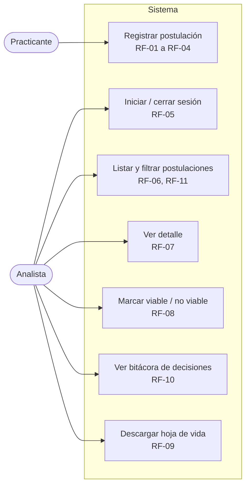
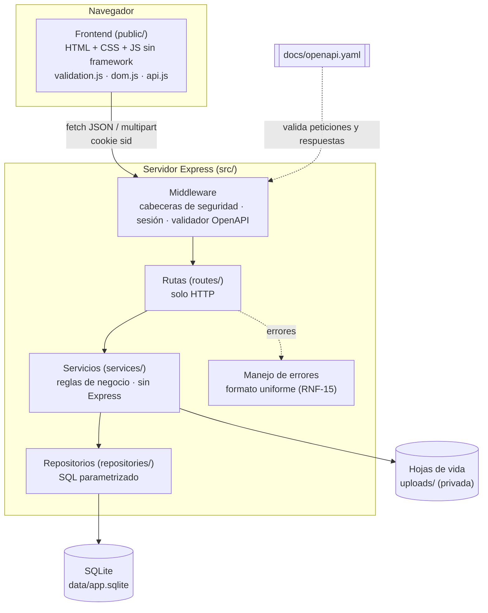
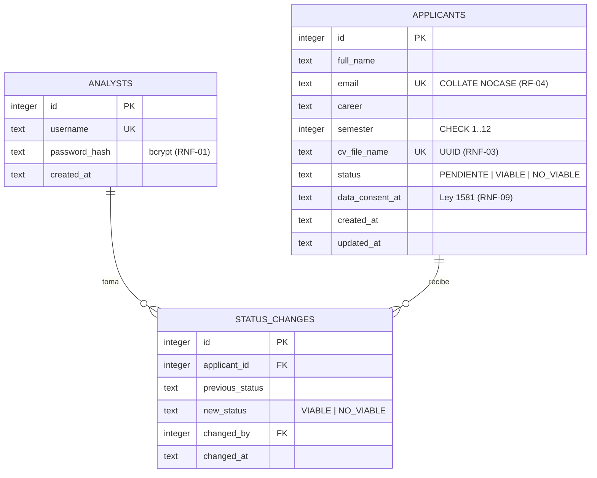
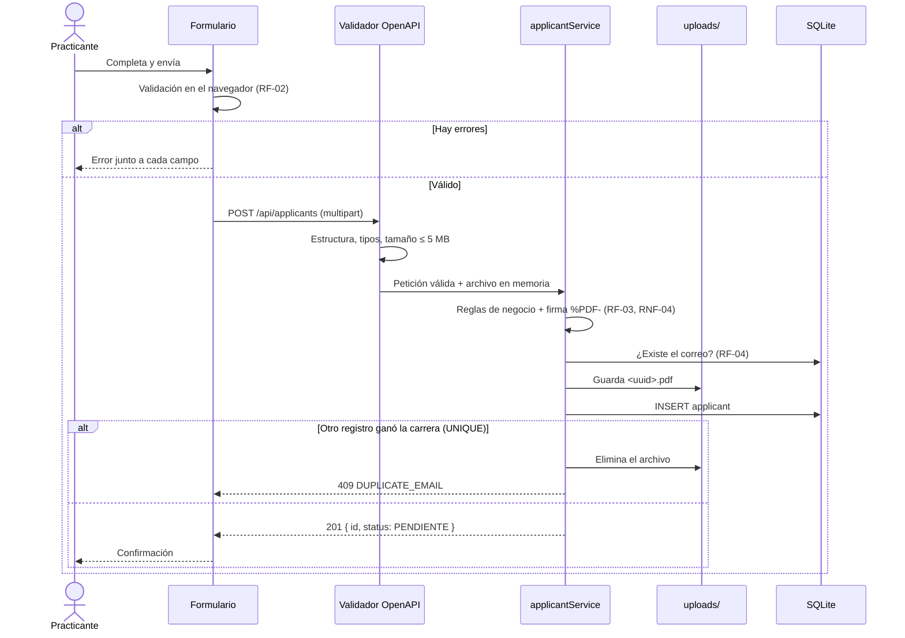
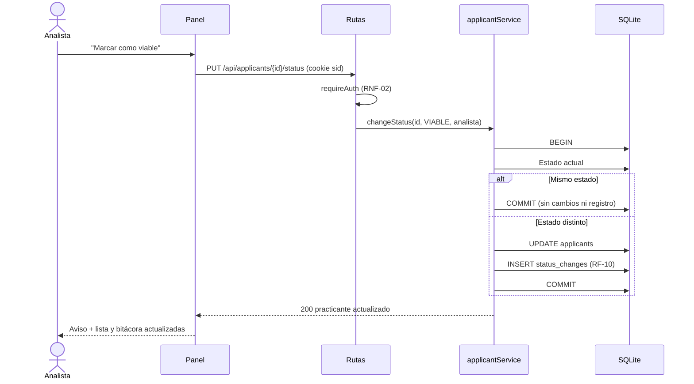

# Arquitectura

Complementa a [`requisitos.md`](requisitos.md) (qué debe hacer el sistema) y a
[`openapi.yaml`](openapi.yaml) (el contrato de la API). Las decisiones y sus alternativas están en
los [ADR](adr/README.md).

## 1. Casos de uso

## 2. Componentes y capas

Una sola aplicación Node.js sirve el frontend y la API. Cada capa solo conoce a la de abajo; las
[pruebas de arquitectura](../tests/unit/architecture.test.js) fallan si esa regla se rompe (RNF-13).

## 3. Modelo de datos

Las restricciones de la base de datos repiten las reglas de negocio principales como defensa en
profundidad: aunque una capa superior fallara, la base de datos rechaza datos inválidos.

## 4. Secuencia: registro de una postulación

El archivo se mantiene en memoria hasta pasar todas las validaciones: una postulación rechazada
nunca deja archivos en el disco.

## 5. Secuencia: decisión del analista

