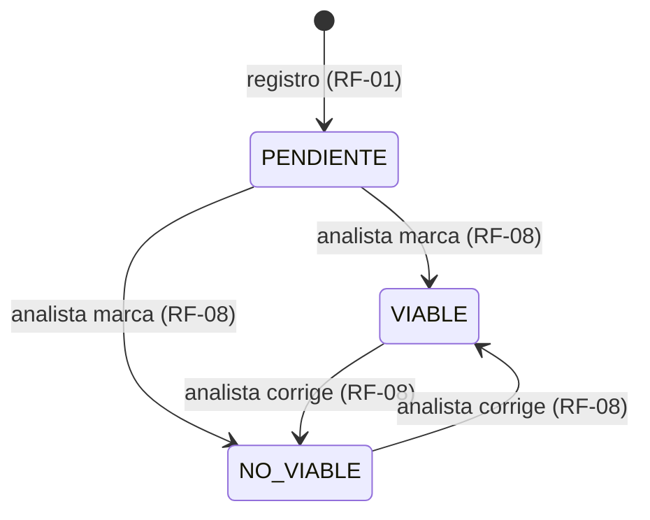

# Especificación de requisitos — Plataforma de Selección de Practicantes

> **Documento prescriptivo.** Este documento define lo que el sistema **debe** hacer y se escribe **antes** del código.
> Toda funcionalidad implementada debe trazarse a un requisito de este documento, y todo requisito
> debe tener al menos una prueba automatizada que lo verifique (ver [Matriz de trazabilidad](#6-matriz-de-trazabilidad)).
> Si el código y este documento difieren, el error está en el código o el documento debe actualizarse primero.

| Campo   | Valor                                            |
| ------- | ------------------------------------------------ |
| Versión | 0.1 (borrador)                                   |
| Estado  | En revisión                                      |
| Fuente  | Kata Practicing – Challenge 1, CoE de Desarrollo |

---

## 1. Propósito y alcance

Herramienta web sencilla para que **practicantes** registren su información y hoja de vida, y para que
**analistas de selección** la revisen y decidan si cada candidato es _viable_ o _no viable_.

La aplicación se ejecuta localmente; no requiere despliegue en la nube.

## 2. Actores

| Actor                 | Descripción                                           | Autenticación             |
| --------------------- | ----------------------------------------------------- | ------------------------- |
| Practicante           | Persona que se postula. Solo registra su información. | No                        |
| Analista de selección | Revisa candidatos y registra la decisión.             | Sí (usuario y contraseña) |

## 3. Modelo de estados del practicante

Todo cambio de estado queda registrado en la bitácora de auditoría (RF-10).

---

## 4. Requisitos funcionales

Prioridad según MoSCoW: **M** = Must (obligatorio del reto), **S** = Should (desafío opcional / valor agregado), **C** = Could (si sobra tiempo).

### Practicante

#### RF-01 — Registrar postulación · **M**

El practicante debe poder enviar un formulario con:

| Campo                                | Regla de validación                                                                  |
| ------------------------------------ | ------------------------------------------------------------------------------------ |
| Nombre completo                      | Obligatorio. 3–100 caracteres tras eliminar espacios al inicio y al final.           |
| Correo electrónico                   | Obligatorio. Formato de correo válido, máx. 254 caracteres. Se guarda en minúsculas. |
| Carrera universitaria                | Obligatorio. 2–100 caracteres.                                                       |
| Semestre actual                      | Obligatorio. Número entero entre 1 y 12.                                             |
| Hoja de vida                         | Obligatorio. Archivo PDF (ver RNF-04 y RNF-05).                                      |
| Autorización de tratamiento de datos | Obligatorio. Debe estar aceptada (ver RNF-09).                                       |

**Criterios de aceptación**

- **CA-01.1** Dado un formulario con todos los campos válidos, cuando se envía, entonces la postulación se guarda con estado `PENDIENTE` y se muestra un mensaje de confirmación.
- **CA-01.2** Dado un registro exitoso, entonces la hoja de vida queda almacenada en la carpeta de archivos del servidor y asociada al practicante.
- **CA-01.3** Dado un formulario sin la autorización de tratamiento de datos aceptada, cuando se envía, entonces se rechaza.

#### RF-02 — Validación en el cliente · **M**

El formulario debe validar los campos obligatorios antes de enviarse y mostrar un mensaje de error **junto a cada campo inválido**.

- **CA-02.1** Dado el campo nombre vacío, cuando el usuario intenta enviar, entonces el formulario no se envía y se muestra el error junto al campo.

#### RF-03 — Validación en el servidor · **M**

El servidor debe aplicar **las mismas reglas de RF-01** sin importar la validación del cliente, que puede saltarse.

- **CA-03.1** Dada una petición directa a la API con datos inválidos, entonces responde `400` indicando cada campo inválido y no guarda nada (ni datos ni archivo).

#### RF-04 — Correo único · **M**

No se permiten dos postulaciones con el mismo correo electrónico.

- **CA-04.1** Dado un correo ya registrado (sin distinguir mayúsculas y minúsculas), cuando se registra de nuevo, entonces responde `409` y no se guarda el archivo.

### Analista

#### RF-05 — Iniciar y cerrar sesión · **S** (desafío opcional 1)

- **CA-05.1** Dadas credenciales válidas, cuando el analista inicia sesión, entonces accede al panel.
- **CA-05.2** Dadas credenciales inválidas, entonces responde `401` con un mensaje genérico que no revela si el usuario existe.
- **CA-05.3** Dado un analista con sesión iniciada, cuando cierra sesión, entonces la sesión se invalida y el panel deja de ser accesible.

#### RF-06 — Listar practicantes · **M**

El analista debe ver la lista de practicantes con nombre, carrera, semestre, estado y fecha de registro, ordenada del más reciente al más antiguo.

- **CA-06.1** Dados practicantes registrados, cuando el analista abre el panel, entonces ve todos los practicantes con los campos indicados.

#### RF-07 — Ver detalle de un practicante · **M**

- **CA-07.1** Dado un practicante existente, cuando el analista lo selecciona, entonces ve todos sus datos.
- **CA-07.2** Dado un identificador inexistente, entonces la API responde `404`.

#### RF-08 — Marcar como viable o no viable · **M**

- **CA-08.1** Dado un practicante, cuando el analista lo marca como `VIABLE` o `NO_VIABLE`, entonces el estado se actualiza y se refleja en el panel.
- **CA-08.2** Dado un valor de estado distinto de `VIABLE` o `NO_VIABLE`, entonces responde `400`.
- **CA-08.3** Una decisión ya tomada puede corregirse (ver diagrama de estados).

#### RF-09 — Descargar hoja de vida · **S** (desafío opcional 2)

- **CA-09.1** Dado un analista con sesión iniciada, cuando descarga la hoja de vida, entonces recibe el PDF con un nombre de archivo legible (p. ej. `CV-nombre-apellido.pdf`).

#### RF-10 — Bitácora de auditoría de decisiones · **S** (valor agregado)

Cada cambio de estado debe registrar: practicante, estado anterior, estado nuevo, analista que lo hizo y fecha y hora.

- **CA-10.1** Dado un cambio de estado, entonces existe un registro de auditoría con todos los campos indicados.
- **CA-10.2** El analista puede ver el historial de decisiones en el detalle del practicante.

#### RF-11 — Filtrar por estado · **C**

- **CA-11.1** Dado el filtro `PENDIENTE`, entonces el listado muestra solo practicantes en ese estado.

---

## 5. Requisitos no funcionales

Cada requisito no funcional es **verificable**: se indica cómo se comprueba.

### Seguridad

| ID     | Requisito                                                                                                                                            | Verificación                                    |
| ------ | ---------------------------------------------------------------------------------------------------------------------------------------------------- | ----------------------------------------------- |
| RNF-01 | Las contraseñas se almacenan con hash **bcrypt** (factor de costo ≥ 10), nunca en texto plano.                                                       | Prueba unitaria + revisión de la BD             |
| RNF-02 | Todas las rutas del panel y de la API de analista exigen sesión válida; sin sesión responden `401`.                                                  | Prueba de integración por ruta                  |
| RNF-03 | Las hojas de vida se guardan **fuera** del directorio público, con un nombre generado (UUID). Solo se acceden mediante la ruta autenticada de RF-09. | Prueba de integración: acceso directo falla     |
| RNF-04 | El tipo de archivo se verifica **por su contenido** (firma `%PDF-`), no solo por la extensión o el tipo MIME declarado.                              | Prueba: `.exe` renombrado a `.pdf` → `400`      |
| RNF-05 | Tamaño máximo del archivo: **5 MB**. Si se excede, responde `413`.                                                                                   | Prueba de integración                           |
| RNF-06 | Todas las consultas a la base de datos son parametrizadas (prevención de inyección SQL).                                                             | Revisión de código + prueba con carga maliciosa |
| RNF-07 | El frontend muestra los datos de los usuarios como texto, nunca como HTML (prevención de XSS).                                                       | Prueba manual con `<script>` en el nombre       |
| RNF-08 | No hay secretos en el repositorio: la configuración va en `.env` (ignorado por git) y se versiona un `.env.example`.                                 | Revisión del repositorio                        |

### Privacidad y cumplimiento

| ID     | Requisito                                                                                                                                                                | Verificación                     |
| ------ | ------------------------------------------------------------------------------------------------------------------------------------------------------------------------ | -------------------------------- |
| RNF-09 | Se solicita la **autorización expresa de tratamiento de datos personales** (Ley 1581 de 2012, Colombia) antes de registrar. La fecha y hora de la aceptación se guardan. | CA-01.3 + prueba de persistencia |
| RNF-10 | Los logs no contienen datos personales (correo, nombre) ni contraseñas.                                                                                                  | Revisión de código               |

### Calidad y mantenibilidad

| ID     | Requisito                                                                                                                                         | Verificación                                |
| ------ | ------------------------------------------------------------------------------------------------------------------------------------------------- | ------------------------------------------- |
| RNF-11 | Desarrollo guiado por pruebas: cada RF tiene al menos una prueba automatizada escrita **antes** de su implementación.                             | Matriz de trazabilidad + historial de git   |
| RNF-12 | La API cumple el contrato `docs/openapi.yaml`. Las peticiones que no se ajustan al contrato se rechazan con `400`.                                | Validador de OpenAPI en ejecución + pruebas |
| RNF-13 | Arquitectura por capas (rutas → servicios → repositorios). Los servicios no dependen de Express.                                                  | Revisión de código                          |
| RNF-14 | Lint y pruebas se ejecutan en integración continua en cada push; la rama principal se mantiene en verde.                                          | GitHub Actions                              |
| RNF-15 | Los errores de la API tienen un formato uniforme `{ "error": { "code", "message", "details?" } }` y nunca exponen trazas internas (stack traces). | Pruebas de integración                      |

### Operación y usabilidad

| ID     | Requisito                                                                                                                                                     | Verificación                           |
| ------ | ------------------------------------------------------------------------------------------------------------------------------------------------------------- | -------------------------------------- |
| RNF-16 | El proyecto se instala y ejecuta con Node.js LTS mediante `npm install && npm run dev`, sin servicios externos. Un comando `seed` crea el analista de prueba. | Instalación limpia siguiendo el README |
| RNF-17 | Los campos del formulario tienen etiquetas asociadas y se pueden usar solo con teclado.                                                                       | Prueba manual                          |

---

## 6. Matriz de trazabilidad

Se completa durante el desarrollo. Cada fila enlaza el requisito con la prueba que lo verifica.

| Requisito                         | Prueba(s)                                                                                                                                         | Estado    |
| --------------------------------- | ------------------------------------------------------------------------------------------------------------------------------------------------- | --------- |
| RF-01                             | `tests/integration/applicants.register.test.js` — CA-01.1, CA-01.2, CA-01.3                                                                       | Cumplido  |
| RF-02                             | —                                                                                                                                                 | Pendiente |
| RF-03                             | `tests/integration/applicants.register.test.js` — CA-03.1 (9 casos + todos los campos a la vez)                                                   | Cumplido  |
| RF-04                             | `tests/integration/applicants.register.test.js` — CA-04.1; `tests/unit/applicantService.test.js` — registros simultáneos                          | Cumplido  |
| RF-05                             | `tests/integration/auth.test.js` — CA-05.1, CA-05.2, CA-05.3, fijación de sesión; `tests/unit/authService.test.js`                                | Cumplido  |
| RF-06                             | `tests/integration/panel.test.js` — CA-06.1 (orden y campos), lista vacía                                                                         | Cumplido  |
| RF-07                             | `tests/integration/panel.test.js` — CA-07.1, CA-07.2                                                                                              | Cumplido  |
| RF-08                             | `tests/integration/panel.test.js` — CA-08.1, CA-08.2, CA-08.3; `tests/unit/applicantReview.test.js` — atomicidad y validación en el servicio      | Cumplido  |
| RF-09                             | `tests/integration/panel.test.js` — CA-09.1; `tests/unit/applicantReview.test.js` — nombre de descarga seguro                                     | Cumplido  |
| RF-10                             | `tests/integration/panel.test.js` — CA-10.1 (incluye analista correcto), CA-10.2, idempotencia; `tests/unit/applicantReview.test.js` — atomicidad | Cumplido  |
| RF-11                             | `tests/integration/panel.test.js` — CA-11.1, estado inexistente → 400                                                                             | Cumplido  |
| RNF-01                            | `tests/integration/auth.test.js` — hash bcrypt con costo ≥ 10; `tests/unit/authService.test.js`                                                   | Cumplido  |
| RNF-02                            | `tests/integration/auth.test.js`, `tests/integration/panel.test.js` — 401 sin sesión en todas las rutas del panel                                 | Cumplido  |
| RNF-03                            | `tests/integration/applicants.register.test.js` — nombre UUID; `tests/integration/panel.test.js` — sin acceso directo, solo descarga autenticada  | Cumplido  |
| RNF-04                            | `tests/integration/applicants.register.test.js` — ejecutable, texto y archivo vacío renombrados a .pdf                                            | Cumplido  |
| RNF-05                            | `tests/integration/applicants.register.test.js` — límite exacto (5 MB) y límite + 1 byte                                                          | Cumplido  |
| RNF-06–08, 10, 11, 13, 14, 16, 17 | —                                                                                                                                                 | Pendiente |
| RNF-09                            | `tests/integration/applicants.register.test.js` — CA-01.3, RNF-09                                                                                 | Cumplido  |
| RNF-12                            | `tests/integration/contract.test.js` + validación de respuestas en todas las pruebas                                                              | Cumplido  |
| RNF-15                            | `tests/unit/errorHandler.test.js`, `tests/integration/contract.test.js`                                                                           | Cumplido  |

---

## 7. Fuera de alcance

| Ítem                                                      | Motivo                                                                                                                        |
| --------------------------------------------------------- | ----------------------------------------------------------------------------------------------------------------------------- |
| Registro o autogestión de analistas                       | Los analistas se crean con el comando `seed`.                                                                                 |
| Recuperación de contraseña, bloqueo por intentos fallidos | Fuera del tiempo del reto; se documenta como trabajo futuro.                                                                  |
| Edición de la postulación por el practicante              | No lo pide el reto.                                                                                                           |
| Notificaciones por correo                                 | No lo pide el reto.                                                                                                           |
| **Calificación automática de hojas de vida con IA**       | **Descartado a propósito:** riesgo de sesgo, envío de datos personales a terceros y la decisión de selección debe ser humana. |
| Despliegue en la nube                                     | El reto permite ejecución local.                                                                                              |

## 8. Supuestos

- S-01: Existe un único rol de analista; todos los analistas tienen los mismos permisos.
- S-02: Un correo electrónico identifica a un único practicante.
- S-03: Una decisión puede corregirse; la trazabilidad la garantiza la bitácora (RF-10).
- S-04: El rango de semestre válido es de 1 a 12.

## 9. Preguntas abiertas (para el canal de Teams del reto)

- P-01: ¿Una decisión de viabilidad debe ser definitiva o puede corregirse? _(Supuesto actual: S-03)_
- P-02: ¿Hay un rango de semestre esperado para practicantes? _(Supuesto actual: S-04)_
- P-03: ¿Se espera algún criterio visible de viabilidad, o la decisión es libre del analista?
